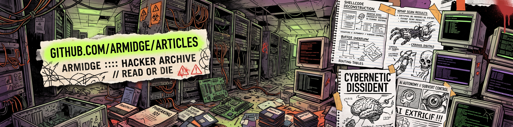

# Articles

Artigos curtos, técnicos e objetivos sobre Segurança da Informação, Cibersegurança, Hacking, Anonimato e OPSEC: fundamentos, raciocínio e aplicação prática, sem enrolação.

## Conteúdo

| Artigo | Data |
|--------|------|
| [Por que a sua privacidade é tão importante](https://github.com/Armidge/Articles/blob/main/Por-que-privacidade-e-importante.md) | 11/2026 |
| [O mínimo que você precisa saber sobre OPSEC & anonimato](https://github.com/Armidge/Articles/blob/main/O-minimo-sobre-OPSEC-anonimato.md) | 11/2026 |
